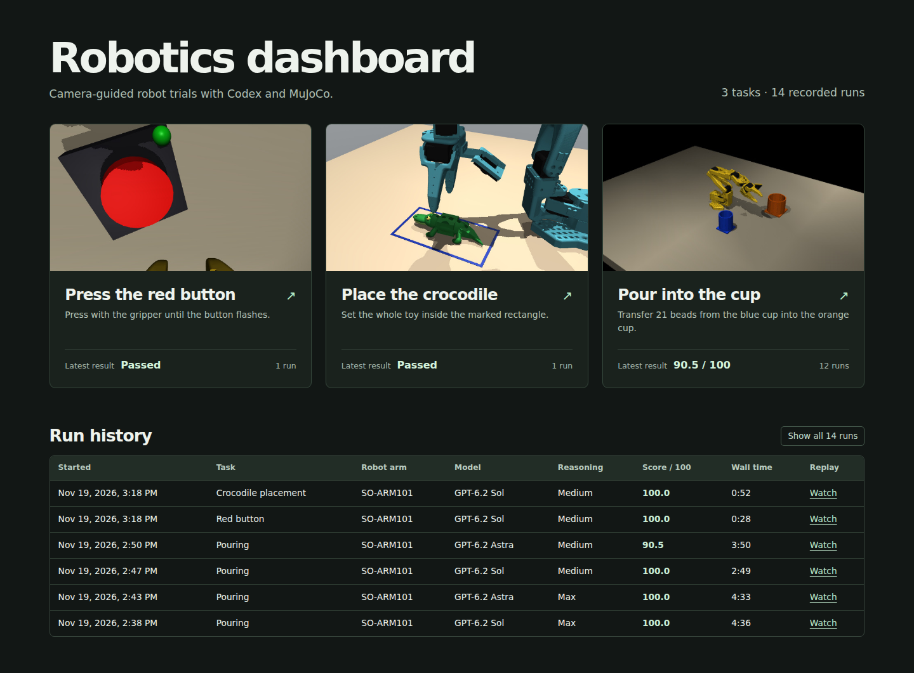

# Codex MuJoCo Robotics

Watch Codex press a button, place a toy crocodile, and pour beads using simulated robot arms. The local dashboard brings together 14 recorded trials, their camera views, model decisions, and independently verified results. The button and crocodile tasks use the SO-ARM101. Pouring trials use both the SO-ARM101 and the I2RT YAM. [Set up the viewer](#run-the-local-viewer) · [Open the local dashboard](http://127.0.0.1:37656/)



## Results

### SO-ARM101 button and crocodile trials

GPT-6.2 Sol completed both tasks on the first trial at Medium reasoning and Standard speed. Each task used seed 101. The model chose target pixels from four RGB cameras and received joint readings and command feedback. Fresh MuJoCo replays reproduced the grades from the saved decisions. The videos follow the recorded wall-clock timing and show the verified outcome for four seconds at the end.

| Task | Result | What the simulator measured | Decisions | Wall time | Recording and evidence |
| --- | --- | --- | ---: | ---: | --- |
| Press the red button | **Pass · 100/100** | The gripper depressed the button 11.60 mm and triggered the flash at 3.202 s of simulated time. | 2 | 28.0 s | [Replay](artifacts/browser-viewer/scenario-runs/button/20261119-151826-sol-medium/replay.mp4) · [Result JSON](artifacts/browser-viewer/scenario-runs/button/20261119-151826-sol-medium/result.json) |
| Place the crocodile in the rectangle | **Pass · 100/100** | All 27 parts of the released toy settled inside the rectangle, with 4.947 mm of clearance at the closest edge. | 3 | 52.4 s | [Replay](artifacts/browser-viewer/scenario-runs/crocodile/20261119-151826-sol-medium/replay.mp4) · [Result JSON](artifacts/browser-viewer/scenario-runs/crocodile/20261119-151826-sol-medium/result.json) |

The button log records a verifier error caused by comparing a Python tuple with a JSON array. After the comparison was corrected, the same two saved decisions reproduced the press. The reported 28.0 s is the recorded trial time.

| Button flash · wrist camera, frame 10 | Crocodile after release · left camera, frame 30 |
| --- | --- |
|  |  |

### Pouring

The arm transfers 21 yellow beads from the blue cup to the orange cup, then sets the cups down upright and releases the gripper.


All twelve trials used Standard inference speed and the same starting layout. The four initial camera views matched across trials for each arm. The table reports final-capture scores from independent physics replays using `final-capture-v3`. Wall time includes model calls, arm motion, grading, verification and video export.

| Arm | Model | Effort | Pouring skills | Beads in target | Outside at finish | Counted as spilled | Score / 100 | Wall time | Replay |
| --- | --- | --- | --- | ---: | ---: | ---: | ---: | ---: | --- |
| SO-ARM101 | GPT-6.2 Sol | Medium | v2 | 21 / 21 | 0 | 0 | 100.0 | 2:49 | [Watch](artifacts/browser-viewer/codex-runs/20261119-144751-586310/replay.mp4) |
| SO-ARM101 | GPT-6.2 Sol | Max | v2 | 21 / 21 | 0 | 0 | 100.0 | 4:36 | [Watch](artifacts/browser-viewer/codex-runs/20261119-143835-613508/replay.mp4) |
| SO-ARM101 | GPT-6.2 Astra | Medium | v2 | 19 / 21 | 2 | 2 | 90.5 | 3:50 | [Watch](artifacts/browser-viewer/codex-runs/20261119-145041-728970/replay.mp4) |
| SO-ARM101 | GPT-6.2 Astra | Max | v2 | 21 / 21 | 0 | 0 | 100.0 | 4:33 | [Watch](artifacts/browser-viewer/codex-runs/20261119-144315-759105/replay.mp4) |
| SO-ARM101 | GPT-6.2 Sol | Medium | v1 | 10 / 21 | 11 | 11 | 47.6 | 3:13 | [Watch](artifacts/browser-viewer/codex-runs/20261119-135814-152629/replay.mp4) |
| SO-ARM101 | GPT-6.2 Sol | Max | v1 | 12 / 21 | 9 | 9 | 57.1 | 5:38 | [Watch](artifacts/browser-viewer/codex-runs/20261119-140806-676657/replay.mp4) |
| SO-ARM101 | GPT-6.2 Astra | Medium | v1 | 8 / 21 | 13 | 13 | 38.1 | 3:02 | [Watch](artifacts/browser-viewer/codex-runs/20261119-141346-823451/replay.mp4) |
| SO-ARM101 | GPT-6.2 Astra | Max | v1 | 15 / 21 | 6 | 6 | 71.4 | 4:46 | [Watch](artifacts/browser-viewer/codex-runs/20261119-141651-967847/replay.mp4) |
| I2RT YAM | GPT-6.2 Sol | Medium | v1 | 8 / 21 | 13 | 13 | 38.1 | 3:11 | [Watch](artifacts/browser-viewer/codex-runs/20261119-112142-227580/replay.mp4) |
| I2RT YAM | GPT-6.2 Sol | Max | v1 | 8 / 21 | 13 | 13 | 38.1 | 6:03 | [Watch](artifacts/browser-viewer/codex-runs/20261119-132720-862589/replay.mp4) |
| I2RT YAM | GPT-6.2 Astra | Medium | v1 | 5 / 21 | 16 | 16 | 23.8 | 3:22 | [Watch](artifacts/browser-viewer/codex-runs/20261119-112916-139006/replay.mp4) |
| I2RT YAM | GPT-6.2 Astra | Max | v1 | 9 / 21 | 12 | 12 | 42.9 | 4:31 | [Watch](artifacts/browser-viewer/codex-runs/20261119-133326-326651/replay.mp4) |

On the repeated SO-ARM101 layout, Sol Medium went from 10 to 21 captured beads, Sol Max from 12 to 21, Astra Medium from 8 to 19, and Astra Max from 15 to 21. The three trials that captured all 21 beads each earned 100.0/100 with zero spills. Astra Medium earned 90.5/100 with two spilled beads.

#### What changed in the second SO-ARM101 pouring experiment

All four first-version runs emptied the blue cup. Offline replay showed why many beads missed the receiver. On the shared layout, missed beads crossed the height of the orange rim roughly 47–48 mm beyond its center in the direction of discharge. The inner rim radius is 41 mm.

The second controller estimates the lowest point of the source rim from arm geometry. As the cup tilts, it lowers the outlet from 90 to 53 mm above the receiving rim and moves it upstream by up to one source-cup radius. It follows a smooth wrist arc with a maximum commanded tilt rate of 28° per second. The model still selects the target from the RGB images.

The revised operator skill asks the model to inspect the stream, hold its tilt if beads are draining and adjust its aim if it sees a persistent miss while beads remain. After each tilt, the next decision also receives four chronological crops of the overhead camera, centered on the model’s chosen aim. Both models used the same skill and controller. Each model and reasoning-effort combination was tested once per revision on this layout, so these results compare the combined changes on that layout. [Pouring skill](artifacts/browser-viewer/skills/so101-pour-v2/SKILL.md) · [Motion controller](artifacts/browser-viewer/so101_controls_v2.py)

Six separate scripted checks isolate the motion change by giving both controllers the same image-derived points and tilt angles for each layout. The revised controller caught 21 beads in five layouts. On seed 166, the blue cup knocked the receiver aside and captured zero, down from six. The mean score across all six rose from 37.3 to 83.3. These checks use scripted decisions and are listed separately from the model runs. Run `MUJOCO_GL=egl python artifacts/browser-viewer/check_so101_skills.py` to reproduce them. [Scripted comparisons](artifacts/browser-viewer/check_so101_skills.py)

#### How pouring is scored

For a valid finished pour, the score is **100 × beads in the orange cup ÷ 21**. Capturing all 21 beads earns 100.0, and capturing 19 earns 90.5. Both cups must be upright, settled, separate and released. Beads still in play must also settle. An unsafe finish or an invalid final state earns zero.

The spill count tracks individual beads that touch the bare tabletop, fall below the table, or finish outside both cups. A bead striking the inside base of the orange cup registers as cup contact. A bead that spills and later lands in the receiver counts once in each measure. The grader also records a separate task-success flag, which requires at least 90% captured, at most one spill, and a stable terminal window. [Full results and run history](artifacts/browser-viewer/codex-runs/run-history.json)

## How Codex controls the arm

For each decision, Codex receives front, left, overhead and wrist RGB images, robot joint readings, and previous command feedback. It chooses an action and its parameters. For a button press, the model chooses an overhead pixel. For crocodile placement, it also chooses the angle at which the jaws close across the toy. For pouring, it chooses a cup rim, aligns the gripper, and controls the tilt. A controller converts each command into joint motion. The simulator grades physical contact or final placement and can replay the recorded commands from the same seed.

This repository hosts local simulations. The button physics and granular-pouring task use the independently developed `robo_mj_bench` project. Artificial Analysis runs its AA-Robotics benchmark on physical hardware. [Upstream benchmark revision](https://github.com/lizimo061/robo_mj_bench/tree/a886b54f3cff4e0994f9d3150e032003935b59c6)

The SO-ARM101 uses five arm joints and a hinged gripper. Its controller approaches the blue cup from the side and lifts it by finger contact. During pouring, it rolls the wrist and adjusts the arm pitch to keep the estimated cup lip over the selected target. The controller uses the calibrated overhead camera and nominal cup dimensions. The SO-ARM101 base is mounted 14 cm closer to the cups along the table’s x-axis to accommodate its shorter reach. The table, cups, 21 beads, three external cameras, and revised evaluator are shared with the YAM. [SO-101 model provenance](artifacts/browser-viewer/models/robotstudio_so101/PROVENANCE.json)

## Physical pouring task in AA-Robotics

Artificial Analysis asks the arm to pour a drink from a bottle into a cup without spilling or breaking anything. In this frame from Artificial Analysis’s video of GPT-6.2 Astra’s physical trial, liquid is visible in the cup and on the table. [Task description](https://artificialanalysis.ai/articles/aa-robotics?aa-robotics-run-task=pour-drink-into-cup) · [Original video by Artificial Analysis](https://x.com/ArtificialAnlys/status/2122757022710104131)


## Run the local viewer

Use Linux with Python 3.12. The commands below clone the project with its pinned benchmark and install the MuJoCo, NumPy, and Pillow versions used for the recorded trials.

```bash
git clone --recurse-submodules https://github.com/thunderrun/codex-mujoco-robotics.git
cd codex-mujoco-robotics
python3.12 -m venv .venv
source .venv/bin/activate
python -m pip install -e ./benchmark 'mujoco==3.17.0' 'numpy==2.3.4' 'Pillow==12.0.0'
MUJOCO_GL=egl python artifacts/browser-viewer/serve.py
```

Open the dashboard and choose a task. The button and crocodile workspaces let you play or scrub through the recorded camera frames alongside the Codex event log. The pouring workspace lets you choose a robot arm, pouring skill, model, inference speed, and reasoning effort for a new run. SO-ARM101 offers v1 or v2 and defaults to v2. I2RT YAM uses its v1 skill. [Dashboard](http://127.0.0.1:37656/) · [Button](http://127.0.0.1:37656/scenarios#button) · [Crocodile](http://127.0.0.1:37656/scenarios#crocodile) · [Pouring](http://127.0.0.1:37656/pouring)

New model trials require a working Linux EGL graphics driver and an authenticated Codex CLI with access to the selected model and speed. The pouring dashboard launcher also requires a systemd user session. The recorded trials used Codex CLI 0.170.0. The video exporters use FFmpeg, ffprobe, and the DejaVu Sans fonts. On Ubuntu the relevant packages include `ffmpeg` and `fonts-dejavu-core`.

To run another camera-guided SO-ARM101 trial on the published layout, set the task to `button` or `crocodile`. Each run writes a new directory under `artifacts/browser-viewer/scenario-runs/` and appears in the dashboard.

```bash
MUJOCO_GL=egl python artifacts/browser-viewer/run_scenario.py --task button --seed 101 --model gpt-6.2-sol --effort medium
```

## Reproduce the archived scores

Replay the two SO-ARM101 trials from their saved model decisions. In the activated environment, these commands rebuild each scene with its recorded seed and compare the physical grade and controller responses with the original run.

```bash
python artifacts/browser-viewer/run_scenario.py --verify artifacts/browser-viewer/scenario-runs/button/20261119-151826-sol-medium
python artifacts/browser-viewer/run_scenario.py --verify artifacts/browser-viewer/scenario-runs/crocodile/20261119-151826-sol-medium
```

For each pouring trial, the following command checks the recorded physics and computes the final-capture grade from a fresh replay. It saves the verified grade alongside the recording. For trials recorded with `final-capture-v3`, it checks the recorded grade directly.

```bash
(
  set -e
  for run in artifacts/browser-viewer/codex-runs/20*/; do
    python artifacts/browser-viewer/verify_codex_pour.py --rescore "$run"
  done
)
```

Each pouring trial directory contains the public event stream, individual model decisions, final status, grader output, physics verification, rendered video, and the first and last four-camera snapshots. The new SO-ARM101 runs include the overhead crops shown after each tilt. Every v1 history row opens the original pouring instructions used with that arm. [SO-ARM101 v1 skill](artifacts/browser-viewer/codex-runs/20261119-141651-967847/pouring-skill.md) · [I2RT YAM v1 skill](artifacts/browser-viewer/codex-runs/20261119-133326-326651/pouring-skill.md)

Each v2 trial archives the exact UTF-8 text sent at every decision. The [viewer’s prompt and skill panel](http://127.0.0.1:37656/pouring#runInstructions) lets you select a run and decision to inspect. Decision receipts list the image views and a SHA-256 digest of the prompt text. The verifier selects each run’s recorded controller revision. Later runs include the model and per-decision settings receipts. The earliest Sol run predates those receipts. Its viewer recorded the original fixed Medium effort under the display label `Standard`.

New pouring runs save their full camera sequences locally and update `artifacts/browser-viewer/codex-runs/run-history.json`. The web viewer serves that history at [the local JSON endpoint](http://127.0.0.1:37656/api/history). The `benchmark` submodule points to the upstream project and retains its own source and asset notices.
