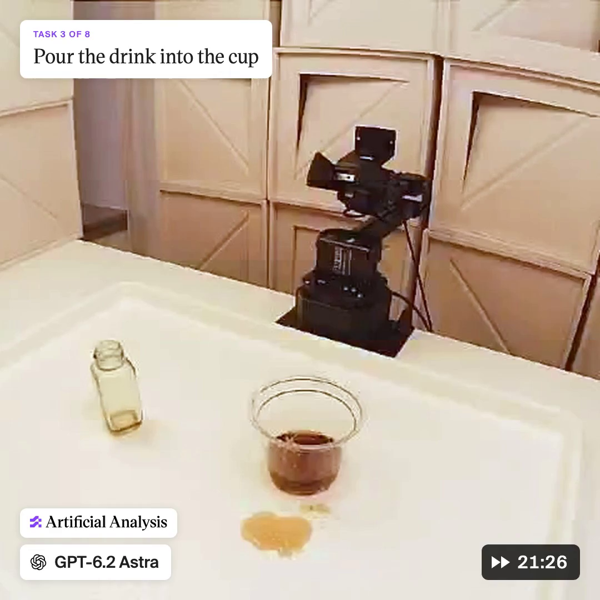

# Pouring with Codex and MuJoCo

Watch Codex operate a simulated SO-ARM101 or I2RT YAM arm in MuJoCo. The goal is to pour 21 yellow beads from a blue cup into an orange cup, then set the cups down upright and release the gripper. The local browser viewer lets you select the arm, shows four camera feeds, streams each model's observations and commands, and keeps a JSON history of runs.


## Results

Each row represents one trial at Standard inference speed with the same initial cups and beads. The arms have different geometry, base positions and wrist cameras. All eight scores use the local `tabletop-v2` evaluator. A fresh physics replay verified each result. Wall time covers the model calls, arm motion, grading, independent verification and video export. The history shows minutes and seconds, and each trial’s `timing.json` records the timestamps and their source.

| Arm | Model | Reasoning effort | Beads in target | Outside cups at finish | Counted as spilled during run | Score / 100 | Wall time | Replay |
| --- | --- | --- | ---: | ---: | ---: | ---: | ---: | --- |
| SO-ARM101 | GPT-6.2 Sol | Medium | 10 / 21 | 11 | 12 | 47.6 | 3:13 | [Watch](artifacts/browser-viewer/codex-runs/20261119-135814-152629/replay.mp4) |
| SO-ARM101 | GPT-6.2 Sol | Max | 12 / 21 | 9 | 10 | 57.1 | 5:38 | [Watch](artifacts/browser-viewer/codex-runs/20261119-140806-676657/replay.mp4) |
| SO-ARM101 | GPT-6.2 Astra | Medium | 8 / 21 | 13 | 15 | 38.1 | 3:02 | [Watch](artifacts/browser-viewer/codex-runs/20261119-141346-823451/replay.mp4) |
| SO-ARM101 | GPT-6.2 Astra | Max | 15 / 21 | 6 | 10 | 71.4 | 4:46 | [Watch](artifacts/browser-viewer/codex-runs/20261119-141651-967847/replay.mp4) |
| I2RT YAM | GPT-6.2 Sol | Medium | 8 / 21 | 13 | 15 | 38.1 | 3:11 | [Watch](artifacts/browser-viewer/codex-runs/20261119-112142-227580/replay.mp4) |
| I2RT YAM | GPT-6.2 Sol | Max | 8 / 21 | 13 | 16 | 38.1 | 6:03 | [Watch](artifacts/browser-viewer/codex-runs/20261119-132720-862589/replay.mp4) |
| I2RT YAM | GPT-6.2 Astra | Medium | 5 / 21 | 16 | 18 | 23.8 | 3:22 | [Watch](artifacts/browser-viewer/codex-runs/20261119-112916-139006/replay.mp4) |
| I2RT YAM | GPT-6.2 Astra | Max | 9 / 21 | 12 | 17 | 42.9 | 4:31 | [Watch](artifacts/browser-viewer/codex-runs/20261119-133326-326651/replay.mp4) |

### How scoring works

A settled, valid partial pour earns 100 × the fraction of all 21 beads in the orange cup, capped at 99. Full credit requires at least 90% in the target, at most one spilled bead, and a successful stability check over the terminal window. For partial credit, both cups must be upright, at rest, released and separate, and all beads still in play must have settled. The spill count records beads seen spilling during the run, including ones that later land in a cup.

The scene has no floor below the table. The revised scorer treats a spilled bead that has fallen completely below the tabletop and is moving downward as lost. That bead earns no transfer credit and counts as spilled. Other beads still have to settle, including beads rolling across the table.

The original SO-ARM101 Sol Medium trial put 10 beads in the target. One spilled bead was still falling below the table at grading, so the upstream evaluator awarded 0.0. Replaying its 14 decisions under the revised rule produced **47.6/100** with identical final positions. The other four archived trials kept their scores. [Original grade](artifacts/browser-viewer/codex-runs/20261119-135814-152629/private/grading.json) · [Revised grade](artifacts/browser-viewer/codex-runs/20261119-135814-152629/private/grading-v2.json) · [Full run history](artifacts/browser-viewer/codex-runs/run-history.json)

## How the trial works

Each Codex decision receives front, left, overhead and wrist RGB images, robot joint encoders, and previous command feedback. The model selects actions such as approaching a cup rim at a chosen overhead pixel, aligning, or tilting to a chosen angle. Each arm has its own controller to translate pixel coordinates and requested tilt into joint motion. The simulator grades the final state separately and stores the seed and final state for replay. This is a local granular-pouring trial based on the independently developed [robo_mj_bench](https://github.com/lizimo061/robo_mj_bench/tree/a886b54f3cff4e0994f9d3150e032003935b59c6). Artificial Analysis runs its separate AA-Robotics benchmark on physical hardware.

The SO-ARM101 uses five arm joints and a hinged gripper. Its controller approaches the blue cup from the side and lifts it by finger contact. During pouring, it rolls the wrist and adjusts the arm pitch to keep the estimated cup lip over the selected target. The controller uses the calibrated overhead camera and nominal cup dimensions. The SO-ARM101 base is mounted 14 cm closer to the cups along the table’s x-axis to accommodate its shorter reach. The table, cups, 21 beads, three external cameras, and revised evaluator are shared with the YAM. [SO-101 model provenance](artifacts/browser-viewer/models/robotstudio_so101/PROVENANCE.json)

## Physical pouring task in AA-Robotics

Artificial Analysis asks the arm to pour a drink from a bottle into a cup without spilling or breaking anything. In this frame from Artificial Analysis’s video of GPT-6.2 Astra’s physical trial, liquid is visible in the cup and on the table. [Task description](https://artificialanalysis.ai/articles/aa-robotics?aa-robotics-run-task=pour-drink-into-cup) · [Original video by Artificial Analysis](https://x.com/ArtificialAnlys/status/2122757022710104131)



## Run the local viewer

Use Linux with Python 3.12. The recorded environment used MuJoCo 3.17.0, NumPy 2.3.4 and Pillow 12.0.0. From the root of this checkout, install the pinned benchmark and Python dependencies, then start the viewer.

```bash
git submodule update --init --recursive
python3.12 -m venv .venv
source .venv/bin/activate
python -m pip install -e ./benchmark 'mujoco==3.17.0' 'numpy==2.3.4' 'Pillow==12.0.0'
MUJOCO_GL=egl python artifacts/browser-viewer/serve.py
```

Open the [local viewer](http://127.0.0.1:37656/). The viewer opens the latest archived run and links each trial to its video. Choose a robot arm, model, inference speed, and reasoning effort, then select **Start run** to begin another trial on the preceding layout.

Launching new trials requires a working Linux EGL graphics driver, a systemd user session, and an authenticated Codex CLI with access to the selected model and speed. The recorded trials used Codex CLI 0.170.0. The video exporter uses FFmpeg, ffprobe, and the DejaVu Sans fonts. On Ubuntu the relevant packages include `ffmpeg` and `fonts-dejavu-core`.

## Reproduce the archived scores

In the activated environment, replay the decisions from the archived runs in fresh, unrendered physics. The command uses the recorded actions and initial layout. For trials recorded with the upstream evaluator, it checks both rules and saves the revised grade and verification alongside the originals. For new trials, it verifies the recorded `tabletop-v2` grade.

```bash
(
  set -e
  for run in artifacts/browser-viewer/codex-runs/20*/; do
    python artifacts/browser-viewer/verify_codex_pour.py --rescore "$run"
  done
)
```

Each trial directory contains the public event stream, individual model decisions, final status, grader output, physics verification, rendered video, and the first and last four-camera snapshots. Later runs also include the model and per-decision settings receipts. The earliest Sol run predates those receipts. Its viewer recorded the original fixed Medium effort under the display label `Standard`.

New runs save their full camera sequences locally and update `artifacts/browser-viewer/codex-runs/run-history.json`. The web viewer serves that history at [the local JSON endpoint](http://127.0.0.1:37656/api/history). The `benchmark` submodule points to the upstream project and retains its own source and asset notices.
